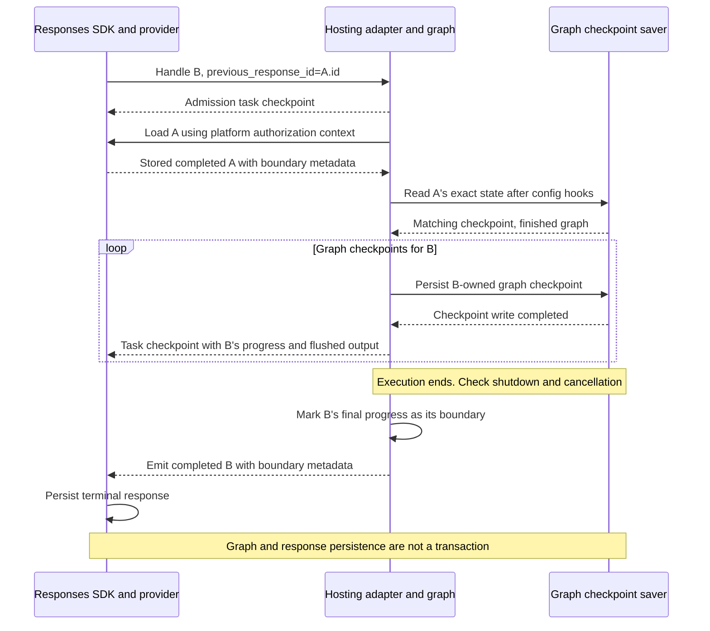

# Response Branching

Checkpoint-based branching is an opt-in feature of `ResponsesHostServer`.
It lets a request continue, fork, or regenerate from a completed parent response.
It is not available through `InvocationsHostServer`.

> **Current limitation:** Only parents whose graph execution has finished are
> supported, with no pending tasks, interrupts, approvals, or tool results.

For setup, start with [Prerequisites](#prerequisites).
For checkpoint handling, see [Implementation approach](#implementation-approach).

## Prerequisites

- Set `enable_response_branching=True`; branching is disabled by default.
- Compile the graph with a **history-preserving checkpointer implementing
  asynchronous reads and writes**. Retain referenced checkpoints and any history
  needed to restore them, not only the thread's latest checkpoint.
- Set **`store=True` on requests whose responses will serve as parents**.
  Those responses must have been created with branching enabled.

The application owns the graph saver's initialization, lifecycle, and retention.
Use a durable saver if checkpoints must survive process recreation.

The name `store` has two different meanings:

| Setting                                                        | Meaning                                                                          |
| -------------------------------------------------------------- | -------------------------------------------------------------------------------- |
| Server constructor: `ResponsesHostServer(..., store=provider)` | A response-provider object controlling where the SDK stores Responses data.      |
| Client request: `client.responses.create(..., store=True)`     | A boolean requesting retention of this response so it can be reused as a parent. |

### Request and configuration limits

An explicit `conversation` without a parent bypasses response branching and
preserves existing conversation behavior. With branching enabled,
`previous_response_id` and `conversation` are mutually exclusive.

Keep `options.steerable_conversations=False` and `app=None`. Steering hands
off an in-flight turn, which completed-parent branching does not support.
The adapter must create its own host for admission and parent-storage setup.
Unsupported combinations raise `ValueError` during initialization.

## Supported contract

| Request                                                             | Selected state                                               | Behavior                                                                   |
| ------------------------------------------------------------------- | ------------------------------------------------------------ | -------------------------------------------------------------------------- |
| Branching enabled, neither parent nor explicit conversation         | A new root thread                                            | Execute fresh input as a root response.                                    |
| Branching enabled, `previous_response_id`, no explicit conversation | The exact checkpoint of a stored, completed, eligible parent | Continue, fork, or regenerate without selecting a sibling's latest state.  |
| Branching enabled, explicit `conversation`, no parent               | Existing conversation checkpoint selection                   | Bypass branching and preserve existing conversation and approval behavior. |
| Branching disabled                                                  | Existing response-chain or conversation checkpoint selection | Preserve the existing default behavior, including partial approvals.       |

A reusable parent must pass all three checks:

1. Its response is stored and has `status="completed"`.
2. Its internal response metadata marks a valid branching boundary and identifies
   the exact graph checkpoint.
3. Its exact graph checkpoint is available and finished, without pending tasks
   or interrupts, and its output has no outstanding approvals or tool results.

`status="completed"` alone is insufficient: an interrupted graph can also
produce a completed response. Supplying all approvals or tool results does not
make a paused parent eligible. The branching path rejects
`mcp_approval_response` and `function_call_output` inputs rather than falling
back to the existing approval/resume flow.

### Open question: complete tool and approval replies

The OpenAI Responses API requires replies for **all outstanding**
`function_call` and `mcp_approval_request` items in the selected response or
conversation and returns **HTTP 400** if any required reply is missing.

Should the host adopt the same validation across tool/approval continuation
flows, **including non-branching requests and explicit-conversation
continuation**, rather than limiting the alignment decision to response
branching?

- For each `function_call`, require a `function_call_output` with a matching
  `call_id`.
- For each `mcp_approval_request`, require an `mcp_approval_response` with a
  matching `approval_request_id`.
- If any required reply is missing, reject the request with **HTTP 400 before
  graph execution or resume**, rather than accepting a partial set of replies.

Adopting this validation remains an **open compatibility decision, not
implemented behavior**. The non-branching path's current support for partial
approvals is also being reconsidered: requiring complete replies and returning
HTTP 400 for missing replies would replace that behavior to align with OpenAI.
Partial-approval support is therefore a description of current behavior, not a
constraint this proposal must preserve.

## Implementation approach

The host selects parents from stored response metadata and wraps graph
checkpoint I/O with a request-local `ResponseCheckpointSaver`. These are
internal implementation details, not public extension points exported from
`langchain_azure_ai.agents.hosting`. There is no separate store for branch
origins or boundaries.

### Storage model

Branching uses the SDK response provider and the graph checkpoint saver.
The existing conversation-chain store is used only by the non-branching path:

| Storage                  | Persisted data                                                                                                                   | Application configuration                                                                                                                        |
| ------------------------ | -------------------------------------------------------------------------------------------------------------------------------- | ------------------------------------------------------------------------------------------------------------------------------------------------ |
| SDK response provider    | Response objects, status, input/output history, and internal task metadata.                                                      | Server constructor's `store=provider`. Defaults to `FileResponseStore` locally or `FoundryStorageProvider` on Foundry.                           |
| Graph checkpoint saver   | Graph state, pending writes, checkpoint history, and response-ownership metadata.                                                | The saver's configuration when compiling the graph. The host delegates storage to it without initializing its backend or managing its lifecycle. |
| Conversation-chain store | A mutable `langgraph_checkpoint` pointer for existing response-chain and explicit-conversation continuation, not a branch index. | `conversation_chain_store`. Defaults to `FoundryConversationChainStore`; branching requests do not read or write it.                             |

A **graph checkpoint** saves LangGraph execution state. An **SDK task
checkpoint** saves response-layer progress, including output and a reference
to graph state, according to SDK persistence policy. Emitting the latter does
not create or replace the former.

Progress is stored in SDK internal metadata as `langgraph_thread_id` and
`langgraph_checkpoint_id`; the admitted mode is
`langgraph_response_branching="checkpoint-v1"`. At completion, the SDK
response's `metadata["_internal_metadata"]` also contains
`langgraph_response_boundary_v1`, a marker with `version="1"`,
`checkpoint_ns=""`, and `paused="true"` or `"false"`. The marker uses the same
progress fields to identify the final checkpoint; it does not duplicate their
IDs in another store. These are SDK-internal persistence fields, not
client-facing metadata or configuration.

Root thread IDs and checkpoint ownership use a user-scoped response key: the
response ID, prefixed with `user-<SHA-256 hex digest of user_id_key>:` when the
platform supplies a nonempty `user_id_key`. This scoping is separate from
backend `user_isolation`. Parent response lookup also uses the platform's
authorization context.

Response retention follows the provider; checkpoint retention follows the graph
saver. Retaining a response does not retain or renew its referenced checkpoint.
For example, `FoundryCheckpointSaver` defaults to a 30-day item TTL;
`item_ttl_seconds=-1` disables expiry. A durable backend is not necessarily
permanent storage.

The adapter does not coordinate retention or cascade response deletion to
graph checkpoints. Applications must align lifetimes and clean up unneeded or
orphaned data through backend facilities. Keep checkpoints referenced by
reusable responses or recoverable tasks, including any history needed to
restore them.

### Checkpoint identity and the three kinds of reference

A branch starts from the parent's **exact graph checkpoint**, not the latest
checkpoint in its thread. It reuses the thread rather than copying state into
a new one. New checkpoints extend the selected history without mutating the
parent checkpoint or rebuilding state from Responses message history.

For example, B and C both select A:

```text
thread T, checkpoint_ns=""

a_final
|-- b_1 --> b_final
`-- c_1 --> c_final
```

Both requests start with `(thread_id=T, checkpoint_id=a_final)`, even if B has
already written newer checkpoints when C starts. This restores non-message
state too, including history needed by channels such as `DeltaChannel`.

Three references describe a response's place in that history:

| Reference | Question it answers                 | Update rule                                                                                                                                                  |
| --------- | ----------------------------------- | ------------------------------------------------------------------------------------------------------------------------------------------------------------ |
| Origin    | Where does this child start?        | Select and validate the parent's exact checkpoint before execution; do not persist a separate child-origin record. A new root response has no parent origin. |
| Progress  | How far has this response executed? | Advance as graph checkpoints are confirmed persisted; use it for background recovery.                                                                        |
| Boundary  | Where did this response end?        | Mark the final progress as a response boundary, with a flag indicating whether the graph paused, and let the SDK store it with the terminal response.        |

These are three roles for checkpoint references, not three persisted records
or copies of graph state.
A boundary marks the end of a **response**, not necessarily a finished graph:
a paused boundary is not an eligible parent. Neither progress nor a boundary
marker alone proves that a stored, completed parent exists.

Two uses of "root" are distinct: a **root response** has no
`previous_response_id`; the **root checkpoint namespace** (`checkpoint_ns=""`)
is used for both root responses and child branches.

### Fresh-request execution

The successful path for a stored child B selecting parent A uses two storage
backends. The SDK owns task-persistence and terminal-response storage policy:



#### 1. Select the parent's recorded boundary

The handler emits an SDK admission checkpoint before provider or graph I/O,
then calls the overridable `build_runnable_config` hook. A new root gets its
user-scoped response ID as the thread ID, initially without a checkpoint ID.
For a child, the default hook calls
`select_branch_checkpoint`:

- Load the parent through `ResponseProviderProtocol.get_response` with the
  current platform context for authorization.
- Check its stored status, boundary metadata, and output eligibility, as
  required by the [supported contract](#supported-contract).
- Select the exact checkpoint identified by its internal progress fields.

A request-local `branch_selection_scope` reuses the selection during configuration
preparation without sharing it across concurrent requests. This first phase
does not read graph state or write another storage record.

#### 2. Validate the actual checkpoint

After the overridable `build_runnable_config` hook returns, the handler merges
graph-bound configuration and calls `validate_branch_checkpoint` with the
final configuration.
This preserves application-specific saver options, such as tenant settings,
while re-pinning `thread_id`, `checkpoint_ns=""`, and `checkpoint_id` to the
selected parent.

The internal `CheckpointRef` carries the thread and checkpoint IDs. The adapter
supplies the namespace, then reads `graph.aget_state` through
`ResponseCheckpointSaver`:

- The returned tuple must match all three requested identity fields, and the
  checkpoint payload must carry the same ID. Missing or mismatched state fails
  rather than falling back to the latest checkpoint.
- The restored snapshot must have no `next` tasks or task interrupts.

Only then does the child execute its input. Failed checkpoint reads or
eligibility checks prevent execution even when response metadata looked valid.

#### 3. Execute new input and persist recoverable progress

The handler makes a shallow copy of the compiled graph and attaches a
request-local `ResponseCheckpointSaver`. The application's original graph and
saver are unchanged. The wrapper delegates serialization, history, version
allocation, and pending writes to that same saver.

The default input converter passes only the current request's input and
instructions; the checkpoint supplies prior state. The graph runs with
`durability="sync"` and `updates`, `messages`, and `checkpoints` stream modes.

For graph checkpoints in the root namespace, the wrapper stamps
`langgraph_response_execution` metadata with a JSON-encoded ownership array:

```text
[response_key, parent_response_id]
```

The parent entry is `null` for a new root response. Private subgraph checkpoints
are not stamped. Recovery uses this identity to distinguish a response's work
from sibling checkpoints without reloading the parent's response or checkpoint
just to validate ownership.

For each graph checkpoint event, the stream converter:

1. Extracts the exact reference and awaits
   `ResponseCheckpointSaver.wait_for_checkpoint`. For a new checkpoint, this
   barrier completes only after the underlying `put` or `aput` succeeds.
2. Uses `TaskStorageManager` to update progress in internal metadata.
3. Flushes pending output-item events and emits `stream.checkpoint()` for SDK
   task persistence before requesting another graph event.

Receiving a graph stream event is not itself proof of persistence. A saver
write failure propagates and fails the response without publishing progress
for that missing checkpoint. Earlier persisted progress remains a separate
recovery point.

An SDK task checkpoint requests persistence according to the SDK's resilient
background policy; yielding it is not a successful-write acknowledgement to
the handler. Recovery uses the last snapshot the SDK actually persisted.

#### 4. Publish the response boundary before terminal completion

After execution, the handler checks shutdown and cancellation. If publication
is required by the request's storage/background policy,
`mark_response_boundary`:

1. Requires a reference matching the response's recorded progress and derives
   `paused` from the run's active interrupts.
2. Adds the boundary marker to the response's stream metadata.

Only afterward does the handler emit `response.completed` for SDK terminal
storage. No separate boundary record is published. Graph checkpoint writes and
SDK response storage are **not a cross-store transaction**. If terminal storage
fails, a graph checkpoint or in-memory boundary marker alone does not make the
response a reusable parent.

Parent selection therefore needs a stored completed response with valid
boundary metadata, as well as the exact finished graph checkpoint.

### Background recovery

The SDK owns recovery admission and policy. The handler seeds its stream from
the persisted response, retaining checkpointed output, and uses the task's
original admitted branching mode rather than the current server flag.
Admission middleware removes client-supplied mode headers before stamping the
server's mode; this is not a client-controlled feature switch. Inconsistent
recovery mode metadata fails explicitly.

Completed nodes' pending writes return as cached updates rather than message
events. The converter restores their missing text and checkpoints emitted
LangGraph message IDs with the response, so persisted text is not appended
again on recovery.

For a child C created from A, recovery first checks C's persisted progress.
If it exists, resume C directly. If no progress was persisted, load A's stored
boundary again, validate its exact checkpoint, and replay C's request input.
No independent origin record is needed:

| Persisted state at recovery                                               | Action                                                                                                                                                            |
| ------------------------------------------------------------------------- | ----------------------------------------------------------------------------------------------------------------------------------------------------------------- |
| New root, with or without progress                                        | Fail; submit a new root request instead of automatically replaying it.                                                                                            |
| Child with no progress fields                                             | Re-read and validate A's exact boundary, then replay C's input. A newer sibling B does not change that selection.                                                 |
| No child progress, and A's response or required checkpoint is unavailable | Fail; there is no retained starting point to replay.                                                                                                              |
| Valid, response-owned child progress                                      | Resume with input `None`, preserving native pending-write recovery. Do not look up A's response.                                                                  |
| Child progress already identifies a finished graph                        | Re-enter from that checkpoint and finish response finalization without executing graph nodes again. A boundary marker is not a separate recovery-rejection fence. |
| Malformed progress, missing/mismatched checkpoint, or wrong ownership     | Fail; do not fall back to A or the thread's latest checkpoint.                                                                                                    |

Before resuming progress, the adapter requires the checkpoint's
`langgraph_response_execution` ownership stamp to match the current response
key **and** requested parent response ID. Matching the thread alone is
insufficient. Not fetching A's response does not remove the saver's requirement
to retain any checkpoint history needed to restore C.

To resume pending work rather than create a fresh fork,
`ResponseCheckpointSaver.resume_config` removes `checkpoint_id` from the outward
execution config but retains its exact reference as a **request-local recovery
head**. The wrapper restores that ID before delegating root reads or writes
without an explicit ID. It advances the head only after a successful save
returning the expected thread, root namespace, and new checkpoint ID.

`put_writes` and `aput_writes` use the same pinned head, preserving task IDs and
supported task paths. A sibling's newer checkpoint therefore cannot redirect
recovery reads or receive this response's pending writes.

This deliberately follows the SDK's ordinary recovery/replay semantics rather
than adding an independent confirmed-origin record or terminal-publication
fence. If C's graph has advanced beyond its last persisted SDK snapshot,
recovery can replay work, and external effects may repeat. A retained terminal
graph checkpoint avoids graph-node replay, but finalization and response
storage may run again. This is not an exactly-once guarantee.

### Implementation entry points

| Source                                                                                                | What to follow                                                                                                                                                                                   |
| ----------------------------------------------------------------------------------------------------- | ------------------------------------------------------------------------------------------------------------------------------------------------------------------------------------------------ |
| [Responses handler](../../langchain_azure_ai/agents/hosting/_responses_host.py)                       | `build_runnable_config`, `handle_create`, `_new_stream`: configuration, execution, and recovery orchestration.                                                                                   |
| [Branch selection and saver wrapper](../../langchain_azure_ai/agents/hosting/_responses/branching.py) | `select_branch_checkpoint`, `validate_branch_checkpoint`, `mark_response_boundary`, `ResponseCheckpointSaver`: metadata selection, exact reads, persistence barriers, and recovery-head pinning. |
| [Graph-stream conversion](../../langchain_azure_ai/agents/hosting/_converters/_stream.py)             | `stream_graph_to_events`, `StreamConverter.checkpoint`: graph persistence before SDK progress publication.                                                                                       |
| [Branching tests](../../tests/unit_tests/agents/hosting/test_response_branching.py)                   | Parent-state preservation, reducer history, configuration hooks, concurrent siblings, write failures, recovery ownership, terminal storage failure, and durable saver recreation.                |

## Local single-worker example

The following uses `InMemorySaver` **only for a local demo**: its checkpoints
disappear on restart even if response records survive. Assuming `model` is
already configured, replace the graph and host construction in the
[basic hosting example](../../README.md#hosting-langgraph-agents-on-microsoft-foundry)
with:

```python
from langchain.agents import create_agent
from langgraph.checkpoint.memory import InMemorySaver

from langchain_azure_ai.agents.hosting import ResponsesHostServer

graph = create_agent(model, tools=[], checkpointer=InMemorySaver())
ResponsesHostServer(graph, enable_response_branching=True).run(port=8088)
```

From a separate client process:

```python
from openai import OpenAI

client = OpenAI(base_url="http://127.0.0.1:8088", api_key="local", max_retries=0)
a = client.responses.create(input="Suggest a destination.", store=True)
b = client.responses.create(
    input="Plan a busy itinerary.", previous_response_id=a.id, store=True
)
c = client.responses.create(
    input="Plan a relaxed itinerary.", previous_response_id=a.id, store=True
)
regenerated_b = client.responses.create(
    input="Plan a busy itinerary.",
    previous_response_id=b.previous_response_id,
    store=True,
)
```

B and C both start from A; C could also start while B is running. Regenerating B
selects B's parent again and creates a new response, potentially with different
output. Client-side undo/rewind similarly selects an earlier parent: it does
not delete history, replay stored SSE events, or undo external effects.

## Failures and limitations

Check the response status or terminal SSE event, not only the HTTP status:
execution errors can arrive as `status="failed"` or `response.failed` after
HTTP admission. Internal branch error codes are logged; the handler reports
branch failures with public error code `server_error`.

| Trigger                                                                                                   | Observable result                                                     | Action                                                                                                              |
| --------------------------------------------------------------------------------------------------------- | --------------------------------------------------------------------- | ------------------------------------------------------------------------------------------------------------------- |
| Branching enabled without the required saver/async methods, with steering, or with an injected host       | Initialization raises `ValueError`.                                   | Use the required graph saver, `steerable_conversations=False`, and `app=None`.                                      |
| Create request includes `response_id`, an invalid `previous_response_id`, or both parent and conversation | HTTP 400 before execution.                                            | Omit `response_id`; use a nonempty string or `null` for the parent, and choose parent or conversation linkage.      |
| Parent is not stored/completed, or lacks a branching boundary                                             | Failed response.                                                      | Select a retained, eligible parent created with branching enabled; a checkpoint alone is insufficient.              |
| Parent is paused or has outstanding approvals/tool results; input contains approval or tool-result items  | Failed response, not an approval resume.                              | Use the existing approval flow outside branching, or select a finished parent and send fresh input.                 |
| Exact checkpoint is missing/mismatched, or parent boundary metadata is invalid                            | Failed response; no fallback to latest state.                         | Restore consistent retained data or choose another eligible parent.                                                 |
| Graph saver write fails                                                                                   | Failed response without progress referencing that missing checkpoint. | Investigate the backend; emitted graph events do not prove that state was saved.                                    |
| SDK terminal storage fails after graph completion                                                         | The graph checkpoint alone does not make a usable parent.             | Inspect SDK storage failures and stored response status; a reusable parent still needs a stored completed response. |

For recovery-specific failures, use the
[recovery state table](#background-recovery).

Operational boundaries:

- Only single-worker execution is supported. A durable saver supports process
  recreation; it does not establish distributed execution guarantees or
  guarantees for actual process-crash windows.
- Only the root checkpoint namespace is selected. Root state may contain
  subgraph outputs or application-owned snapshot references, but private
  persistent subgraph histories are not rewound or isolated by the host.
- Checkpointed instruction messages keep their existing persistence behavior.
- Checkpoint selection does not provide exactly-once external effects.
  Applications remain responsible for side-effect safety.
