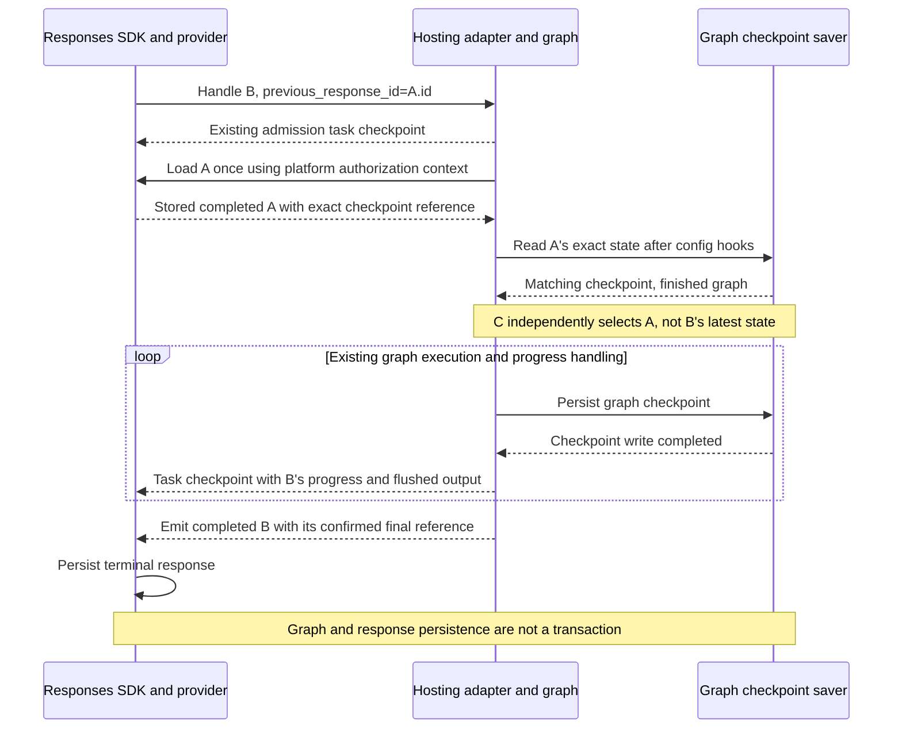

# Response Branching

Checkpoint-based branching is an opt-in feature of `ResponsesHostServer`.
It lets a request continue, fork, or regenerate from a completed parent response.
It is not available through `InvocationsHostServer`.

> **Current limitation:** Only parents whose graph execution has finished are
> supported, with no pending tasks, interrupts, approvals, or tool results.

For setup, start with [Prerequisites](#prerequisites).
For checkpoint handling, see [Implementation approach](#implementation-approach).

## Prerequisites

- Set `enable_response_branching=True`; branching is disabled by default.
- Compile the graph with a **history-preserving checkpointer implementing
  asynchronous reads and writes**. Retain referenced checkpoints and any history
  needed to restore them, not only the thread's latest checkpoint.
- Set **`store=True` on requests whose responses will serve as parents**.
  Their stored metadata must identify a retained, exact graph checkpoint.
  A parent created without branching enabled is also eligible if it passes
  the same completion and checkpoint checks.

The application owns the graph saver's initialization, lifecycle, and retention.
Use a durable saver if checkpoints must survive process recreation.

The name `store` has two different meanings:

| Setting                                                        | Meaning                                                                          |
| -------------------------------------------------------------- | -------------------------------------------------------------------------------- |
| Server constructor: `ResponsesHostServer(..., store=provider)` | A response-provider object controlling where the SDK stores Responses data.      |
| Client request: `client.responses.create(..., store=True)`     | A boolean requesting retention of this response so it can be reused as a parent. |

Foreground `store=False` requests are supported for both roots and children,
including streaming. A child can still start from an eligible stored parent,
but its own unsaved response cannot be selected as a later parent. Another
request can select the original stored parent again. The SDK rejects
`background=True, store=False` before graph execution.

Request-level `store=False` does **not** disable the application's graph
checkpointer: graph execution still reads and writes checkpoints and pending
writes as needed. It does not delete those checkpoints afterward or guarantee
no storage I/O or retained graph data. Response retention and graph retention
remain separate policies.

### Request and configuration limits

An explicit `conversation` without a parent bypasses response branching and
preserves existing conversation behavior. With branching enabled,
`previous_response_id` and `conversation` are mutually exclusive.

Keep `options.steerable_conversations=False` and `app=None`. Steering hands
off an in-flight turn, which completed-parent branching does not support.
The adapter must create its own host for admission and parent-storage setup.
Unsupported combinations raise `ValueError` during initialization.

## Supported contract

| Request                                                             | Selected state                                               | Behavior                                                                   |
| ------------------------------------------------------------------- | ------------------------------------------------------------ | -------------------------------------------------------------------------- |
| Branching enabled, neither parent nor explicit conversation         | A new root thread                                            | Execute fresh input as a root response.                                    |
| Branching enabled, `previous_response_id`, no explicit conversation | The exact checkpoint of a stored, completed, eligible parent | Continue, fork, or regenerate without selecting a sibling's latest state.  |
| Branching enabled, explicit `conversation`, no parent               | Existing conversation checkpoint selection                   | Bypass branching and preserve existing conversation and approval behavior. |
| Branching disabled                                                  | Existing response-chain or conversation checkpoint selection | Preserve the existing default behavior, including partial approvals.       |

A reusable parent must pass all three checks:

1. Its response is stored and has `status="completed"`.
2. Its internal response metadata identifies the exact final graph checkpoint.
3. Its exact graph checkpoint is available and finished, without pending tasks
   or interrupts, and its output has no outstanding approvals or tool results.

`status="completed"` alone is insufficient: an interrupted graph can also
produce a completed response. Supplying all approvals or tool results does not
make a paused parent eligible. The branching path rejects
`mcp_approval_response` and `function_call_output` inputs rather than falling
back to the existing approval/resume flow.

### Open question: complete tool and approval replies

The OpenAI Responses API requires replies for **all outstanding**
`function_call` and `mcp_approval_request` items in the selected response or
conversation and returns **HTTP 400** if any required reply is missing.

Should the host adopt the same validation across tool/approval continuation
flows, **including non-branching requests and explicit-conversation
continuation**, rather than limiting the alignment decision to response
branching?

- For each `function_call`, require a `function_call_output` with a matching
  `call_id`.
- For each `mcp_approval_request`, require an `mcp_approval_response` with a
  matching `approval_request_id`.
- If any required reply is missing, reject the request with **HTTP 400 before
  graph execution or resume**, rather than accepting a partial set of replies.

Adopting this validation remains an **open compatibility decision, not
implemented behavior**. The non-branching path's current support for partial
approvals is also being reconsidered: requiring complete replies and returning
HTTP 400 for missing replies would replace that behavior to align with OpenAI.
Partial-approval support is therefore a description of current behavior, not a
constraint this proposal must preserve.

## Implementation approach

Response branching adds **exact starting-state selection** to the existing
Responses hosting path. Execution, persistence, and recovery use the shared
hosting mechanisms described below, not a separate branching subsystem.

### Minimal branching mechanism

Branching changes **where new work starts**, not how the graph runs. Recovery
continues work for the same response; it is not another kind of parent
selection. After mode routing, preparation has three outcomes:

| Entry condition | Starting state | Graph input |
| --------------- | -------------- | ----------- |
| Recovery with valid saved progress for this response | Its exact owned checkpoint, using native resume semantics. | `None`; do not inject the original input again. |
| Fresh request or recovery without progress, with a parent | The stored completed parent's exact eligible checkpoint. | Current request input and instructions. |
| Fresh request or recovery without progress, without a parent | The existing new-root configuration. | Current request input and instructions. |

Malformed or unusable saved progress is an error, not permission to select a
parent or replay input instead.

All three preparations feed the same execution lifecycle:

```text
prepared configuration and input
    -> graph execution
    -> output conversion and confirmed progress publication
    -> SDK finalization and response-storage policy
```

This is a responsibility boundary, not a proposal for new runner or context
classes. Keep the existing configuration and input hooks. Non-branching and
explicit-conversation requests retain their existing routing and HITL handling.

### Reuse boundaries

| Responsibility | Existing mechanism to reuse | Branching-specific increment |
| -------------- | --------------------------- | ---------------------------- |
| Admission and response lifecycle | Responses SDK validation, context, provider authorization, `store`/`background` policy, task persistence, and terminal events. | Stamp the server-selected mode and validate branching linkage. |
| Runnable configuration | Existing `build_runnable_config` hook, `HostingRunnableConfig`, graph-bound configuration, and user scoping. | Select an exact eligible parent instead of an implicit thread head; validate after application hooks. |
| Graph execution and output | Existing `build_input`, graph stream, cancellation, interrupt tracking, usage accumulation, and output converters. | Send fresh input from the selected state; do not enter ordinary approval/tool-result resume handling. |
| Graph persistence | Application-configured checkpoint saver, serializer, history, pending writes, and retention. | No new backend or branch-specific storage lifecycle. |
| Progress and recovery | Existing `TaskStorageManager`, response-stream restoration from the persisted SDK snapshot, and SDK recovery admission. | Preserve the exact response-owned checkpoint when siblings share a graph thread; close any missing guarantee in the common path. |

The shared checkpoint adaptation supplies exact native resume and graph-write
confirmation where the upstream execution API alone does not provide them.
Branch selection does not introduce another storage backend or recovery policy.

### Storage model

Keep one authority for each kind of data:

| Storage | Authoritative data | Ownership and reuse |
| ------- | ------------------ | ------------------- |
| SDK response provider | Response status, input/output history, and internal task progress. | Existing `store=provider`; defaults to `FileResponseStore` locally or `FoundryStorageProvider` on Foundry. |
| Graph checkpoint saver | Graph state, exact checkpoint identity, pending writes, history, and checkpoint ownership metadata. | The application compiles and manages the saver. The host reuses it without initializing another backend or changing its lifecycle. |
| Existing conversation-chain store | The legacy continuation pointer, not a branch index or proof of response completion. | Existing `conversation_chain_store`, defaulting to `FoundryConversationChainStore`; see [pointer scope](#scope-of-the-existing-continuation-pointer). |

A **graph checkpoint** saves LangGraph execution state. An **SDK task
checkpoint** saves response-layer progress, including output and a reference
to graph state, according to SDK persistence policy. Emitting the latter does
not create or replace the former.

Progress is stored in SDK internal metadata as `langgraph_thread_id` and
`langgraph_checkpoint_id`; the admitted mode is
`langgraph_response_branching="checkpoint-v1"`. Completion retains the
same confirmed progress reference alongside the SDK response status, without
a second origin record or completion marker. These are SDK-internal fields,
not client-facing metadata or configuration.

Root thread IDs and checkpoint ownership use a user-scoped response key: the
response ID, prefixed with `user-<SHA-256 hex digest of user_id_key>:` when the
platform supplies a nonempty `user_id_key`. This scoping is separate from
backend `user_isolation`. Parent response lookup also uses the platform's
authorization context.

Response retention follows the provider; checkpoint retention follows the graph
saver. Retaining a response does not retain or renew its referenced checkpoint.
For example, `FoundryCheckpointSaver` defaults to a 30-day item TTL;
`item_ttl_seconds=-1` disables expiry. A durable backend is not necessarily
permanent storage.

The adapter does not coordinate retention or cascade response deletion to
graph checkpoints. Applications must align lifetimes and clean up unneeded or
orphaned data through backend facilities. Keep checkpoints referenced by
reusable responses or recoverable tasks, including any history needed to
restore them.

### Checkpoint identity and reference reuse

A branch starts from the parent's **exact graph checkpoint**, not the latest
checkpoint in its thread. It reuses the thread rather than copying state into
a new one. New checkpoints extend the selected history without mutating the
parent checkpoint or rebuilding state from Responses message history.

For example, B and C both select A:

```text
thread T, checkpoint_ns=""

a_final
|-- b_1 --> b_final
`-- c_1 --> c_final
```

Both requests start with `(thread_id=T, checkpoint_id=a_final)`, even if B has
already written newer checkpoints when C starts. This restores non-message
state too, including history needed by channels such as `DeltaChannel`.

The selected parent is request-local starting-state information. Once execution
starts, the response's existing progress fields identify its own saved work.
On completion, the final reference is simply the last confirmed progress
reference; it does not need a different record or schema.

The parent checks are a stored completed response, its exact final
reference, and restored graph state with no pending tasks or interrupts.
The stored output must also have no outstanding approvals or tool results.
A completed **response** can still represent a paused graph, so neither
response status nor a checkpoint reference alone is sufficient. Restoring
graph state supplies the eligibility check instead of a persisted copy of
a `paused` flag.

Two uses of "root" are distinct: a **root response** has no
`previous_response_id`; the **root checkpoint namespace** (`checkpoint_ns=""`)
is used for both root responses and child branches.

### Fresh-request execution

Only preparation of the starting state differs from ordinary execution:

1. A new root uses the existing user-scoped root-thread configuration.
2. A child loads its stored parent once with the platform authorization context.
   Configuration hooks reuse that selection. Graph-state validation happens
   after the hooks and graph-bound configuration merging, so application saver
   settings are preserved.
3. Validate the parent's exact identity and finished state before checking
   unsupported approval/tool-result input items. These are separate checks.
   Missing or mismatched checkpoints fail; they never fall back to latest.
4. Pass the current input and instructions through the existing execution and
   output pipeline. The checkpoint supplies prior message and non-message state;
   do not reconstruct it from Responses history.
5. Use common progress persistence and SDK finalization. Confirm each graph
   write before publishing its reference in a task snapshot or terminal response.

For a stored child B selecting A, the flow is:



An emitted graph checkpoint event is not itself proof of a successful write.
A write failure must not publish a reference to missing state. Likewise,
yielding an SDK task checkpoint requests persistence under SDK policy; it is
not an acknowledgement that the SDK snapshot was saved. A failed terminal
response write cannot be repaired by treating the graph checkpoint as a
completed response.

### Incremental I/O budget

The budget concerns parent-response reads added by branching, not SDK history
fetches or the saver's normal checkpoint/history I/O:

| Entry path | Parent-response reads | State and input decision |
| ---------- | --------------------- | ------------------------ |
| Fresh root | None. | Configure a new root and execute its input. |
| Fresh child | One authorized lookup, reused during request preparation. | Validate the selected parent, then execute new input. |
| Recovery with saved progress | None. | Validate this response's progress and resume it with input `None`. |
| Root recovery without progress | None. | Replay the root request through the common path. |
| Child recovery without progress | One authorized lookup, reused during request preparation. | Validate the exact parent again, then replay the child input. |

There are no additional branch-origin, branch-boundary, or global-head record
writes. Reuse parent selections only within one request; do not cache eligibility
across requests. Required graph reads after final configuration and required
write confirmation are not redundant I/O and must not be skipped to meet a
read-count target.

### Background recovery

The host uses one recovery policy for root responses and children. The SDK
owns recovery admission and persistence policy; the host restores the last SDK
snapshot actually persisted, including output and the originally admitted mode.
Client-supplied mode headers are sanitized, not treated as a recovery switch.
Automatic crash recovery requires SDK opt-in and stored background work;
removing the root restriction does not make foreground requests recoverable.

After configuration hooks and bound-config merging, apply this decision:

| Persisted state | Shared recovery action |
| --------------- | ---------------------- |
| Valid progress for this response, root or child | Check exact identity and ownership, then resume with input `None`; do not fetch the parent response. |
| Root with no progress | Replay its original request using the existing root configuration. |
| Child with no progress | Re-read and validate its exact completed parent, then replay the child input. |
| Required parent unavailable when replay is needed | Fail; do not select a sibling or latest state. |
| Malformed progress, unavailable/mismatched checkpoint, or wrong ownership | Fail; do not silently switch to request replay or a parent checkpoint. |
| Owned progress already identifies a finished graph | Finalize the response without rerunning graph nodes. |

Root shutdown defers to SDK recovery policy just like child shutdown;
completed-parent eligibility is not a restriction on recovering existing work.
Ownership checks must distinguish responses and their requested parents when
they share a graph thread. Reuse saved checkpoint metadata for those checks;
do not fetch the parent merely to validate owned progress. Retained graph
history may still be required to restore that checkpoint.

**Exact native resume is a shared integration concern.** In the LangGraph
implementation examined for this design, explicitly supplying `checkpoint_id`
selects replay rather than reuse of completed tasks' pending writes. Removing
it without pinning reads can instead select a sibling's latest state. Any
necessary adaptation therefore lives in common recovery. It pins the exact
request-local recovery head while omitting `checkpoint_id` from the outward
execution config, preserving pending-write task identity. The head advances
only after a successful save. Parent selection is not repeated for recovery
with owned progress.

Recovery ownership is checked in the graph's checkpoint read, without a separate
preflight read. Branching requires a matching response/parent ownership stamp.
The non-branching path also rejects mismatched stamps but accepts absent stamps
for compatibility with existing pre-adapter recovery snapshots.

Reuse the existing output converter to restore text from cached completed-node
updates without duplicating output already saved in the SDK snapshot. If graph
state advanced beyond that snapshot, recovery may repeat work and external
effects. Finalization and response storage may also repeat; this is not an
exactly-once guarantee.

### Scope of the existing continuation pointer

The existing pointer key is the user-scoped SDK `conversation_chain_id`, not
the selected LangGraph thread ID. Do not equate an SDK execution scope with a
globally selected branch or the latest checkpoint in a whole branch tree.
For example, SDK 2.3 uses the individual response ID for this scope when both
explicit conversation and steering are absent, as in the supported branching
mode. Forks can share a graph thread without sharing this SDK key.

Keep the existing non-branching pointer semantics explicit:

- An explicit conversation uses the SDK's conversation-scoped identity.
- The host writes available progress after the graph stream returns normally,
  before shutdown/cancellation checks and terminal response persistence. This
  can include paused or cancelled work. Re-emitting pending interrupts without
  a resume input also retains the selected reference.
- An exception before that update does not advance the pointer. A later SDK
  terminal-storage failure does not roll back an already written pointer.
- The host adds no ordering across concurrent writes to the same key; the
  configured store determines their outcome. With overwrite-style storage, the
  last applied write wins, not necessarily the latest request in time.

Branching intentionally neither reads nor writes this legacy pointer: the
selected parent's stored response and the current response's own progress are
the authoritative references it needs. This avoids an unused side-store write,
not a required graph checkpoint write. A cross-fork latest or UI-selected head
would be a separate feature, not an index inferred by this implementation.

### Shared checkpoint adaptation

`ResponseCheckpointSaver` in the existing task-storage module is a request-local,
**asynchronous hosting adapter**, used by branching and ordinary checkpointed
execution. It is not a replacement for the application's general-purpose saver.
The application graph and saver remain unchanged.

The adapter keeps only integration responsibilities:

- Exact checkpoint reads, preserving application configuration and namespace.
- Response-owned native recovery, including pinned pending writes.
- Confirmation that a checkpoint was saved before SDK progress references it.
- Delegation of serialization and channel-version allocation to the original saver.

Synchronous private subgraphs can inherit the adapter, so their read/write calls
pass through to the original saver without accessing root recovery state.
Native subgraph replay also delegates checkpoint history queries. Deletion and
lifecycle remain on the application's original graph and saver. Async
delta-channel restoration uses asynchronous checkpoint reads. Root progress
confirmation needs no cross-thread futures or locks.

Parent eligibility stays in branch preparation. Completion reuses progress,
without a boundary marker; legacy markers are ignored. Root and child recovery
share the same SDK policy. Cached-output restoration stays in the shared output
converter, rather than a second branching pipeline.

Removing the old marker eliminates redundant metadata and consistency rules,
not a standalone backend write: it was embedded in the SDK response. The concrete
I/O savings are reused parent lookup and removal of a separate recovery-validation
read, while necessary checkpoint reads and writes remain.

### Implementation entry points

| Source | Responsibility to follow |
| ------ | ------------------------ |
| [Responses handler](../../langchain_azure_ai/agents/hosting/_responses_host.py) | Existing configuration hooks, execution, finalization, and recovery orchestration. |
| [Task storage and checkpoint adaptation](../../langchain_azure_ai/agents/hosting/_responses/task_storage_manager.py) | Shared progress references, exact asynchronous reads, persistence confirmation, and native recovery. |
| [Branch preparation](../../langchain_azure_ai/agents/hosting/_responses/branching.py) | Admission, completed-parent selection, and eligibility checks after configuration hooks. |
| [Graph-stream conversion](../../langchain_azure_ai/agents/hosting/_converters/_stream.py) | Shared output conversion and checkpoint-to-SDK progress ordering. |
| [Branching tests](../../tests/unit_tests/agents/hosting/test_response_branching.py) | Parent isolation, configuration hooks, concurrent siblings, persistence failures, and recovery. |

Internal helper classes are not public extension points.

## Local single-worker example

The following uses `InMemorySaver` **only for a local demo**: its checkpoints
disappear on restart even if response records survive. Assuming `model` is
already configured, replace the graph and host construction in the
[basic hosting example](../../README.md#hosting-langgraph-agents-on-microsoft-foundry)
with:

```python
from langchain.agents import create_agent
from langgraph.checkpoint.memory import InMemorySaver

from langchain_azure_ai.agents.hosting import ResponsesHostServer

graph = create_agent(model, tools=[], checkpointer=InMemorySaver())
ResponsesHostServer(graph, enable_response_branching=True).run(port=8088)
```

From a separate client process:

```python
from openai import OpenAI

client = OpenAI(base_url="http://127.0.0.1:8088", api_key="local", max_retries=0)
a = client.responses.create(input="Suggest a destination.", store=True)
b = client.responses.create(
    input="Plan a busy itinerary.", previous_response_id=a.id, store=True
)
c = client.responses.create(
    input="Plan a relaxed itinerary.", previous_response_id=a.id, store=True
)
regenerated_b = client.responses.create(
    input="Plan a busy itinerary.",
    previous_response_id=b.previous_response_id,
    store=True,
)
```

B and C both start from A; C could also start while B is running. Regenerating B
selects B's parent again and creates a new response, potentially with different
output. Client-side undo/rewind similarly selects an earlier parent: it does
not delete history, replay stored SSE events, or undo external effects.

## Failures and limitations

Check the response status or terminal SSE event, not only the HTTP status:
execution errors can arrive as `status="failed"` or `response.failed` after
HTTP admission. Internal branch error codes are logged; the handler reports
branch failures with public error code `server_error`.

| Trigger                                                                                                   | Observable result                                                     | Action                                                                                                              |
| --------------------------------------------------------------------------------------------------------- | --------------------------------------------------------------------- | ------------------------------------------------------------------------------------------------------------------- |
| Branching enabled without the required saver/async methods, with steering, or with an injected host       | Initialization raises `ValueError`.                                   | Use the required graph saver, `steerable_conversations=False`, and `app=None`.                                      |
| Create request includes `response_id`, an invalid `previous_response_id`, or both parent and conversation | HTTP 400 before execution.                                            | Omit `response_id`; use a nonempty string or `null` for the parent, and choose parent or conversation linkage.      |
| Parent is not stored/completed, or lacks a valid checkpoint reference                                     | Failed response.                                                      | Select a retained, eligible parent with exact checkpoint metadata; a checkpoint alone is insufficient.              |
| Parent is paused or has outstanding approvals/tool results; input contains approval or tool-result items  | Failed response, not an approval resume.                              | Use the existing approval flow outside branching, or select a finished parent and send fresh input.                 |
| Exact checkpoint is missing/mismatched, or response checkpoint metadata is invalid                        | Failed response; no fallback to latest state.                         | Restore consistent retained data or choose another eligible parent.                                                 |
| Graph saver write fails                                                                                   | Failed response without progress referencing that missing checkpoint. | Investigate the backend; emitted graph events do not prove that state was saved.                                    |
| SDK terminal storage fails after graph completion                                                         | The graph checkpoint alone does not make a usable parent.             | Inspect SDK storage failures and stored response status; a reusable parent still needs a stored completed response. |

For recovery decisions and failures, see the
[recovery state table](#background-recovery).

Operational boundaries:

- Only single-worker execution is supported. A durable saver supports process
  recreation; it does not establish distributed execution guarantees or
  guarantees for actual process-crash windows.
- Only the root checkpoint namespace is selected. Root state may contain
  subgraph outputs or application-owned snapshot references, but private
  persistent subgraph histories are not rewound or isolated by the host.
- Checkpointed instruction messages keep their existing persistence behavior.
- Checkpoint selection does not provide exactly-once external effects.
  Applications remain responsible for side-effect safety.
