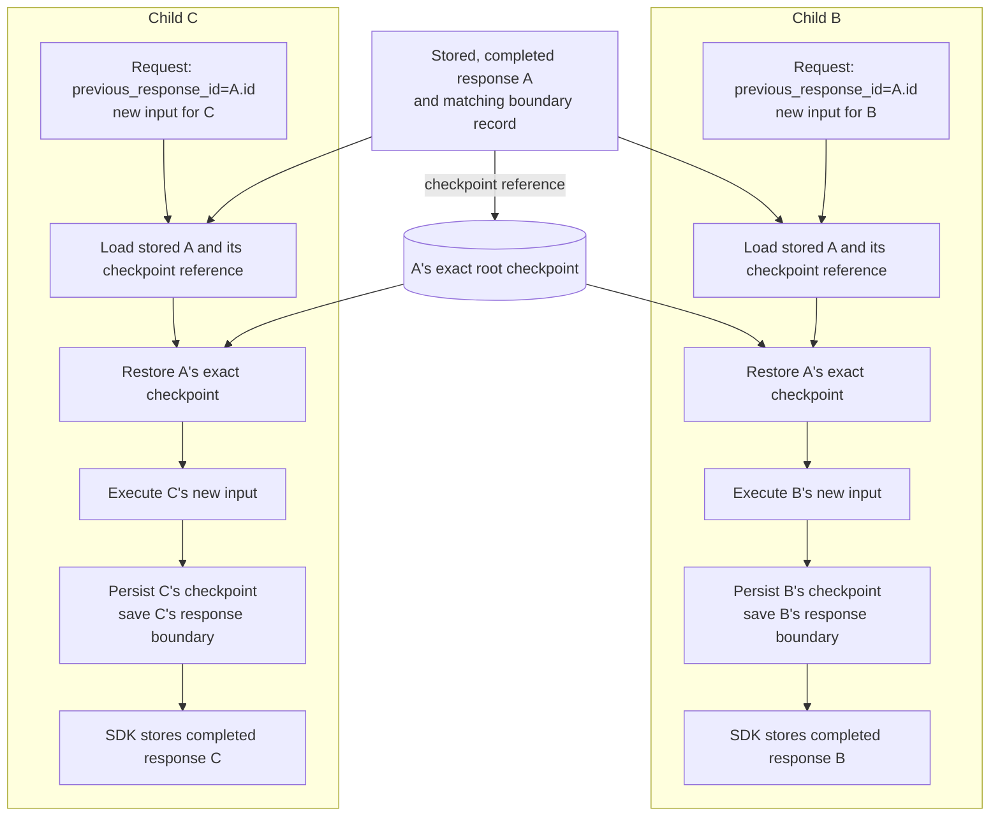

# Response Branching

Checkpoint-based branching is an opt-in feature of `ResponsesHostServer`.
It is not available through `InvocationsHostServer`.

> **Current limitation:** Only parents whose graph execution has finished are
> supported, with no pending tasks, interrupts, approvals, or tool results.
> Paused-parent support is planned separately.

## Prerequisites

- Set `enable_response_branching=True` on `ResponsesHostServer`; branching is
  disabled by default.
- Compile the graph with a **history-preserving checkpointer that implements
  asynchronous reads and writes**. Retain the exact checkpoints that parent
  responses reference, not only the latest checkpoint in a thread.
- Use **`store=True` for every response that will serve as a parent**. A parent
  must have been created with branching enabled and have a stored, completed
  response, matching branch records, and an eligible graph checkpoint.
  **A checkpoint alone is not enough without the stored parent response.**

Use a **durable, history-preserving saver** for deployments that must retain
graph state across process restarts. The application configures and manages the
checkpointer and its retention; the host does not create or manage it.
`InMemorySaver` is only a local, single-worker demo option: its checkpoints
disappear on restart, even if the response records survive.

### Request and configuration limits

If a request specifies `conversation`, the host follows the existing
conversation behavior and **does not apply response branching**, even when
`enable_response_branching=True`.

With `enable_response_branching=True`, both configuration constraints apply:

- Keep `options.steerable_conversations` set to `False` (the default).
  Steering lets a new turn redirect an in-flight turn in the same conversation:
  the new input queues while the active handler cooperatively winds down.
  That handoff from an active turn is not supported by the current
  completed-parent branching implementation.
- Leave `app=None` so `ResponsesHostServer` creates its own
  `ResponsesAgentServerHost`. The branching integration requires the
  adapter-owned setup for request admission and parent-response storage;
  injecting an existing host is not supported.

Enabling steering or passing an existing host through `app` raises `ValueError`
**during initialization**. These are rejected configurations, not requests
that simply bypass branching.

## Supported contract

| Request | Selected state | Behavior |
| --- | --- | --- |
| Branching enabled, neither parent nor explicit conversation | A new root thread | Execute the input and record its exact root checkpoint. |
| Branching enabled, `previous_response_id`, no explicit conversation | The exact checkpoint of a stored, completed, eligible parent | Continue, fork, or regenerate without selecting a sibling's latest state. |
| Branching enabled, explicit `conversation` | Existing conversation checkpoint selection | Bypass response branching and preserve existing conversation and approval behavior. |
| Branching disabled | Existing response-chain or conversation checkpoint selection | Preserve the existing default behavior, including partial approvals. |

An eligible parent must have been created with branching enabled and must have
matching stored response and checkpoint records. Its **graph execution must
also be finished**: no pending tasks or interrupts, no outstanding approvals,
and no function calls awaiting results. `response.status == "completed"` alone
is insufficient because a graph interrupted for approval can also produce a
completed response.

This initial scope deliberately excludes:

- Branching or resuming from a paused parent, even when the request contains
  all of its approval responses or tool results.
- Processing `mcp_approval_response` or `function_call_output` inputs on the
  response-branching path.
- Copying paused checkpoints, preserving approval IDs across partial replies,
  or remapping functional-task identities.
- Deciding whether partial approvals/results should be accumulated or rejected,
  or when such inputs should trigger further graph execution.

The existing default and explicit-conversation paths are unchanged. The new
branching path does not silently fall back to those paths for an unsupported
parent. Approval and tool-result aggregation can be addressed separately.

## Implementation approach

| Component | Responsibility |
| --- | --- |
| Responses SDK | Own response storage and status, input/output history, and background-task and recovery policy. |
| Hosting adapter (`ResponsesHostServer`) | Validate the selected parent, resolve its exact root checkpoint, and record each response's origin, progress, and completed boundary. |
| Graph checkpointer | Persist graph snapshots and pending writes, including non-message state and response-ownership metadata, using application-managed storage and retention. |

### Storage model

`ResponseBranchStore` does **not** introduce a new storage backend. It keeps
small, versioned records in the existing `conversation_chain_store`, separate
from both the SDK response store and the graph checkpoint saver:

| Storage | Initialization and application configuration | Persisted data |
| --- | --- | --- |
| SDK response store | The host creates `FileResponseStore` locally or `FoundryStorageProvider` on Foundry, unless the application supplies `store`. Use `store=True` and retain reusable parent responses. | Response objects, status, input/output history, and internal metadata containing checkpoint references and boundary markers. |
| Branching records | The host creates `ResponseBranchStore` over the supplied `conversation_chain_store`, or the default `FoundryConversationChainStore`. That default lazily creates or reuses `FoundryStateStore` namespaces; supply an appropriately configured store for custom storage, isolation, or TTL requirements. | Per-response confirmed origins and completed boundaries, not graph snapshots. |
| Graph checkpoint saver | The application creates and configures the saver when compiling the graph, including durable storage, async support, and history retention. The host wraps it but does not initialize its backend or manage its lifecycle. | Actual graph state, pending writes, and response-ownership metadata used to validate recovery progress. |

Branch records are keyed by `(response_key, record_key)`. The response key is
the response ID, prefixed with `user-<SHA-256 hex digest of user_id_key>:` when
the platform supplies a nonempty `user_id_key`. This response/user scoping is
separate from backend `user_isolation` settings. The default store uses the
namespace `langchain_azure_ai.agents.hosting/responses/<response_key>`.
Each child has its own records rather than sharing one conversation-wide
branch head.

Both records are string dictionaries with `version="1"` and the root
`checkpoint_ns=""`:

| Record key | Main fields and meaning |
| --- | --- |
| `langgraph_branch_origin_v1` | A child's confirmed parent: `parent_response_id`, `mode="checkpoint-v1"`, the parent's `thread_id` and `checkpoint_id`, and `paused="false"`. Written after parent validation, before child execution. |
| `langgraph_response_boundary_v1` | This response's resulting `thread_id` and `checkpoint_id`, plus `paused="true"` or `"false"`. A paused boundary is recorded but cannot be selected as a branching parent. |

In the SDK response's `metadata["_internal_metadata"]`, the boundary marker
contains the version, root namespace, and paused flag. Its exact reference is
stored alongside it as `langgraph_thread_id` and `langgraph_checkpoint_id`.
The adapter checks that these fields agree with the boundary record.
SDK task metadata also retains the admitted mode as
`langgraph_response_branching="checkpoint-v1"` and this response's confirmed
progress reference. These are references into the graph saver, not snapshots.
A saver alone cannot establish whether a response was stored and completed,
which checkpoint is its boundary, or which origin was confirmed for a child.

Response retention follows the response provider; checkpoint retention follows
the graph saver. The default branching-record store uses a write-sliding item
TTL of 30 days; configure `FoundryConversationChainStore(item_ttl_seconds=...)`
to change it (`-1` disables expiry). These settings apply when the underlying
store is first created, not on reuse, and reads do not renew the TTL.
The adapter does not coordinate these retention policies or cascade SDK
response deletion to branch records or graph checkpoints. The application must
align their lifetimes and clean up unneeded or orphaned records and snapshots
using backend facilities: `ConversationChainStoreProtocol` defines only
`get` and `set`, not deletion. Retain checkpoints referenced by reusable
responses or recoverable tasks; missing or expired records fail explicitly.

### Execution and recovery

In this flow, B and C both select A, regardless of whether B has already
produced newer checkpoints:



Parent selection is reused only within one request. The adapter validates the
exact saved graph state after application configuration hooks and bound graph
configuration have been applied, even for custom overrides. Only then is the
child's origin saved. Each child executes new input from that selected
checkpoint and records its own checkpoints and response without changing A.

Checkpoint writes finish before their progress references become recoverable.
After execution, the adapter saves the completed-boundary index and adds its
marker to response metadata, then emits completion for the SDK to store the
terminal response. The checkpoint, boundary index, and stored completed
response must agree before that response can be reused as a parent. A boundary
index alone is insufficient; these ordered writes are not a single
cross-store transaction.

When SDK background recovery is enabled, the adapter uses the admitted mode
and confirmed origin, then verifies that any saved progress belongs to this
response and its selected parent before resuming. It never selects a sibling's
latest state. A child without recorded progress can replay its input from its
confirmed origin. Interrupted new roots are not replayed automatically, and
responses with a published terminal boundary are not repaired or re-executed
automatically.

## Local single-worker example

The following uses `InMemorySaver` **only for a local demo**; checkpoints are
lost on restart. For a deployment, use a durable, history-preserving saver
instead. Replace the graph and host construction in the basic hosting example
with:

```python
from langgraph.checkpoint.memory import InMemorySaver

from langchain_azure_ai.agents.hosting import ResponsesHostServer

graph = create_agent(model, tools=[], checkpointer=InMemorySaver())
ResponsesHostServer(graph, enable_response_branching=True).run(port=8088)
```

From a separate client process:

```python
from openai import OpenAI

client = OpenAI(base_url="http://127.0.0.1:8088", api_key="local", max_retries=0)
a = client.responses.create(input="Suggest a destination.", store=True)
b = client.responses.create(
    input="Plan a busy itinerary.", previous_response_id=a.id, store=True
)
c = client.responses.create(
    input="Plan a relaxed itinerary.", previous_response_id=a.id, store=True
)
regenerated_b = client.responses.create(
    input="Plan a busy itinerary.",
    previous_response_id=b.previous_response_id,
    store=True,
)
```

Both B and C start from A's root state, including non-message graph state.
C may start while B is still running; it does not select B's intermediate
checkpoint. Regeneration creates a new response and may produce different
output. Client-side undo/rewind selects an earlier response as the next parent;
it does not delete history, replay stored SSE events, or undo external effects.

## Failures and limitations

- Invalid linkage fields can return HTTP 400 before execution. A parent that is
  paused, unavailable, inconsistent, or not stored and completed produces a
  response with `status="failed"` or an SSE `response.failed` event. Check the
  response status or terminal event, not only the HTTP status.
- For example, if A returned a pending `mcp_approval_request`, a create request
  with `previous_response_id=A.id` fails on the branching path. Supplying a
  partial or complete approval batch does not make A eligible in this scope.
- Missing or mismatched exact checkpoints fail explicitly. There is no fallback
  to a thread's latest checkpoint.
- New branches select only the root namespace. Root state can contain subgraph
  outputs or application-owned snapshot references, but private persistent
  subgraph histories are not rewound or isolated by the host.
- With `enable_response_branching=True`, enabling
  `options.steerable_conversations` or injecting a `ResponsesAgentServerHost`
  through `app` raises `ValueError` during initialization.
- Checkpointed instruction messages retain their existing persistence behavior.
- `store=False` responses are not reusable parents. Background task and response
  storage policy remain SDK-owned.
- Supported deployment scope is a single worker. `InMemorySaver` loses state at
  shutdown; use a history-preserving durable saver for process recreation.
- Recovery uses the admitted mode, confirmed origin, and response-owned progress.
  An interrupted new root is not replayed automatically. A response with a
  published terminal boundary is not repaired or re-executed automatically.
- Exactly-once external effects, distributed execution, and actual
  process-crash windows are not guaranteed by this feature.
